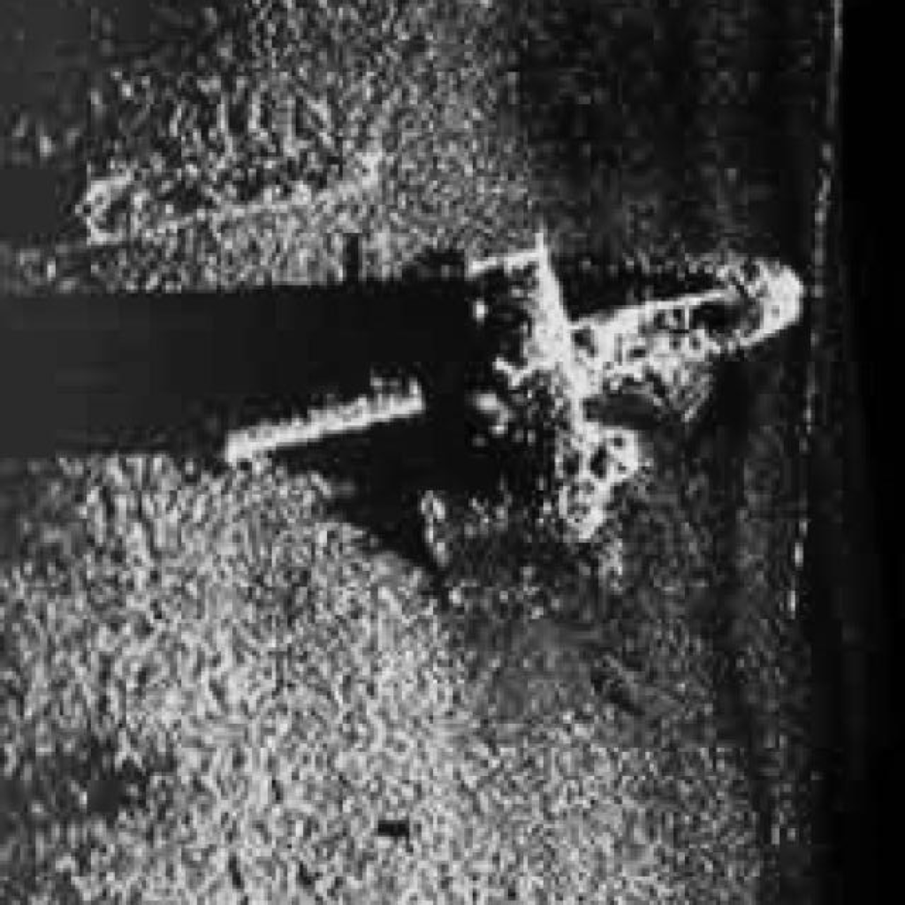
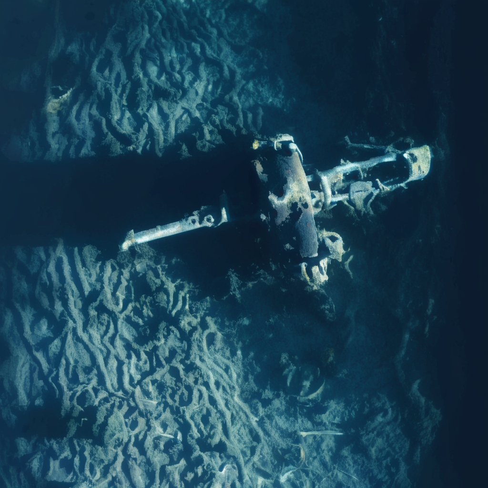

# Sonar Image Enhancement and 3D Visualization Using Stable Diffusion XL and DAv3

## Overview
This Final Year Project focuses on enhancing noisy sonar images into clearer and more meaningful visual outputs using AI-based image generation and image processing techniques. The project also explores 3D visualization by estimating depth information from the enhanced image results.

The main purpose of this project is to improve the interpretability of sonar imagery while preserving the original object structure, silhouette, and viewpoint as much as possible. The system combines preprocessing, Stable Diffusion XL img2img enhancement, multi-view generation, and DAv3-based depth estimation for visualization.

## Objectives
- Enhance noisy sonar images into clearer visual representations.
- Preserve object shape, silhouette, and structural consistency during enhancement.
- Explore denoising and multi-view generation techniques for improved visualization.
- Generate depth-based 3D visualization from enhanced sonar images.
- Evaluate the similarity and quality of the generated outputs.

## Problem Statement
Raw sonar images are often noisy, unclear, and difficult for humans to interpret. Traditional image enhancement methods may improve visibility, but they often fail to preserve meaningful structure or support downstream 3D interpretation. This project addresses this issue by using AI-based diffusion and image processing methods to enhance sonar images while maintaining structural consistency for visualization purposes.

## Scope
This project includes:
- Sonar image preprocessing
- Image enhancement using Stable Diffusion XL img2img
- Denoising and structure preservation
- Multi-view image generation
- Depth estimation using DAv3
- Depth-based 3D visualization
- Evaluation of enhanced image quality and similarity

This project does not focus on fully accurate engineering-grade 3D reconstruction, but rather on improving visual understanding and structural interpretation from sonar imagery.

## Methodology
The overall workflow of the project is as follows:

1. **Input Sonar Image**  
   A raw sonar image is provided as the input.

2. **Preprocessing**  
   Image preprocessing is applied to prepare the sonar image for enhancement. This may include resizing, denoising, brightness adjustment, masking, and color adaptation.

3. **Image Enhancement**  
   Stable Diffusion XL img2img is used to generate a clearer and more visually meaningful version of the sonar image while attempting to preserve the original structure.

4. **Multi-View Generation**  
   Additional views are generated to improve the visualization of the detected object from different angles.

5. **Depth Estimation**  
   DAv3 is used to estimate depth from the enhanced image.

6. **3D Visualization**  
   The estimated depth is used to generate a point cloud or depth-based 3D visualization.

7. **Evaluation**  
   The outputs are evaluated based on similarity, structural preservation, and visual quality.

## Technologies Used
- Python
- Stable Diffusion XL (img2img)
- DAv3
- OpenCV
- PyTorch
- Gradio
- Google Colab
- GitHub

## Features
- Sonar image enhancement
- Denoising and preprocessing pipeline
- Structure-preserving image generation
- Multi-view generation
- Depth estimation for visualization
- 3D point cloud visualization
- Interactive interface for image processing

## Results
The project produced enhanced sonar image outputs with improved visual clarity and depth-based visualization support. In one experimental setup, the enhancement pipeline achieved **46% similarity across 4 test images**.

## Sample Results

This section shows an example of the original sonar input image and the final enhanced output generated by the system.

### Input Sonar Image

### Enhanced Output Image

