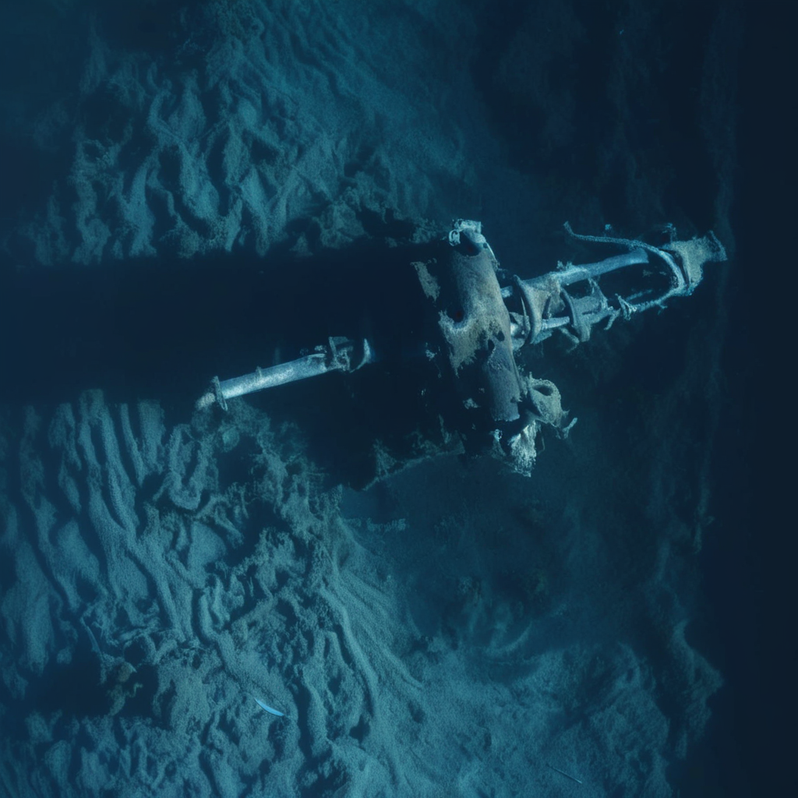

# Sonar Imagery Enhancement and 3D Visualisation

A final-year research project exploring how vision-language models, Stable Diffusion XL, and depth estimation can make noisy sonar imagery easier to interpret. The workflow investigates generated visual enhancements, alternative views, and depth-based 3D visualisations.

**Focus:** generative AI · computer vision · experimental evaluation · 3D visualisation

**[Explore the experiments](ui_bridge/batch_evaluation_results_small)** · **[View 3D exports](ui_bridge/da3_exports)** · **[Inspect test images](test_image)**

## Visual example

The input and generated output below come from the same saved experiment (`image1`, raw preprocessing).

| Sonar input | Generated visualisation |
| --- | --- |
|  |  |

Generated details are model interpretations. They should not be treated as verified observations of the underwater object or as survey-grade geometry.

## Problem and approach

Sonar images can be difficult to interpret because of noise, limited texture, and ambiguous object boundaries. This project explores whether preprocessing, language-guided image generation, and depth estimation can produce more accessible visual representations while retaining useful structural cues.

```text
Sonar image → Preprocessing / object cutout → Vision-language prompt
                         ↓                           ↓
                  Canny edge guidance → SDXL image generation
                                                   ↓
                                  Alternative-view experiments
                                                   ↓
                                     Depth / 3D visualisation
```

The saved run metadata identifies Qwen3-VL-8B-Instruct for visual prompting and Juggernaut-XL-v9 as the SDXL model. It also records a custom ControlNet path and YOLO segmentation weights. The project documentation describes DAv3-based depth estimation, with scene, depth, and geometry exports available here.

## Experimental evidence

The saved [batch report](ui_bridge/batch_evaluation_results_small/batch_report.json) records **48 completed runs across 8 test images**, comparing three factors with two settings each:

| Experiment | Comparison | Evaluation file |
| --- | --- | --- |
| A — preprocessing | Raw input vs brightened input | [Results](ui_bridge/batch_evaluation_results_small/experiment_A_raw_vs_brighten_evaluation.csv) |
| B — SDXL input | Blue input vs grayscale input | [Results](ui_bridge/batch_evaluation_results_small/experiment_B_evaluation.csv) |
| C — negative prompt | Enabled vs disabled | [Results](ui_bridge/batch_evaluation_results_small/experiment_C_negative_prompt_evaluation.csv) |

The evaluation CSVs contain DINO image-to-image cosine similarity and CLIP image-to-text cosine similarity. These measure representation similarity and prompt alignment, rather than detection accuracy or geometrically correct reconstruction.

A separate [alternative-view experiment](multi_view_negative_prompt_experiment) compares generation with and without negative prompts. Its [evaluation CSV](multi_view_negative_prompt_experiment/multi_view_negative_prompt_evaluation.csv) includes prompts, generation settings, timings, and similarity scores.

### Recorded baseline settings

The batch report records SDXL strength `0.47`, guidance scale `7`, `40` steps, seed `163272`, a target long side of `1024`, ControlNet scale `1.3`, and the `DPM++ 2M Karras` scheduler. Individual run folders include effective settings, prompts, intermediate images, and final output.

## Repository guide

| Location | Contents |
| --- | --- |
| [`test_image/`](test_image) | Eight input sonar images. |
| [`ui_bridge/batch_evaluation_results_small/`](ui_bridge/batch_evaluation_results_small) | Experiment outputs, intermediate images, prompts, metadata, and evaluation CSVs. |
| [`multi_view_negative_prompt_experiment/`](multi_view_negative_prompt_experiment) | Alternative-view examples and negative-prompt comparisons. |
| [`ui_bridge/sdxl_final_output/`](ui_bridge/sdxl_final_output) | Selected final image outputs. |
| [`ui_bridge/da3_exports/`](ui_bridge/da3_exports) | Scenes, depth previews, `.glb` geometry, and `.npz` data. |

## How to review the work

1. Compare an experiment folder's `01_raw_input.png`, `05_canny_control.png`, and `06_final_output.png` to see how the generated image relates to its input and edge guidance.
2. Read its `metadata.json`, `qwen_prompt.txt`, and `used_sdxl_prompt.txt` to inspect the recorded settings and prompts.
3. Use the linked CSVs to compare settings across images, rather than judging only the selected example above.
4. Open a scene's `depth_vis/0000.jpg` and `scene.jpg` under `ui_bridge/da3_exports/`, or download its `scene.glb` for a compatible 3D viewer.

## Reproducibility and limitations

This repository publishes **research outputs and experiment records**. It does not contain the Python source, notebooks, environment specification, or custom model weights needed to rerun the pipeline. Paths beginning with `/content/drive/` in the metadata refer to the original Google Colab environment.

- Eight test images provide a small exploratory sample; these results do not establish general performance on other sonar datasets.
- Diffusion-generated images and alternative views can introduce plausible but unsupported details.
- Depth estimates derived from generated images are exploratory visualisations, not validated metric reconstructions.
- The saved settings help explain individual runs, but full reproduction requires the missing implementation, dependencies, and model assets.

## Project context

Final-year project by **Hoi Wen Han**, Raffles University. The documented workflow uses Python, PyTorch, OpenCV, Stable Diffusion XL, vision-language prompting, Gradio, Google Colab, and DAv3-based depth estimation.
